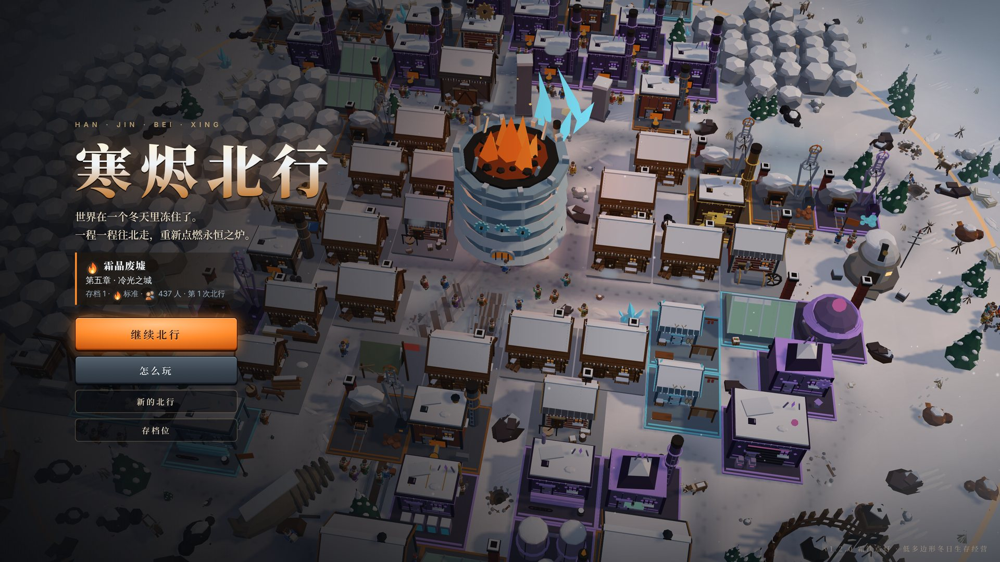
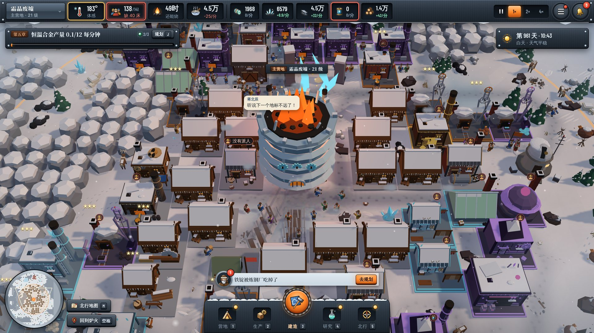
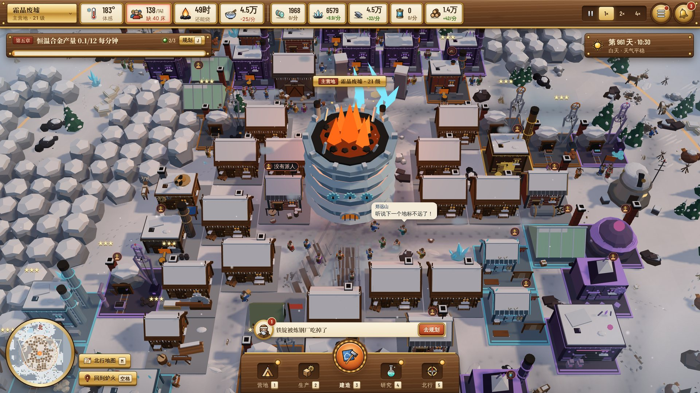
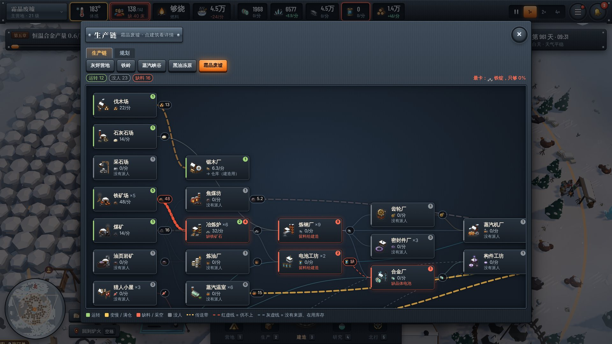
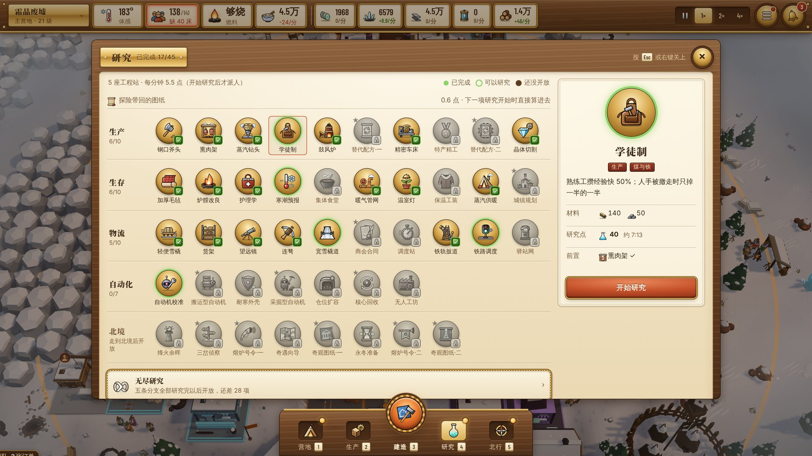
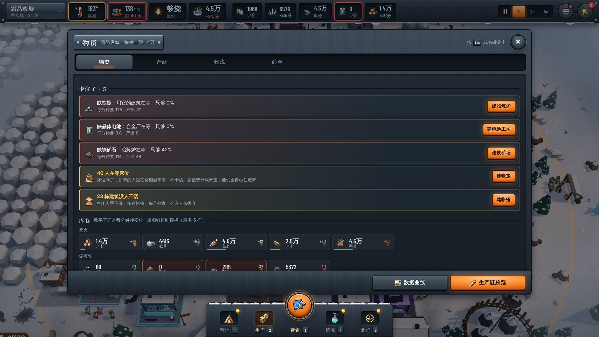
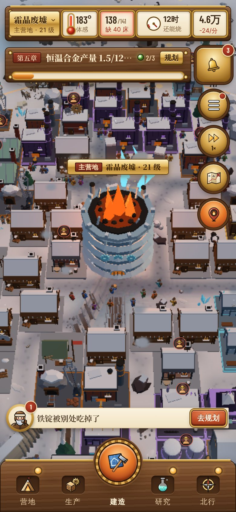

<div align="center">



# 寒烬北行 · Cold Embers

**世界在一个冬天里冻住了。一程一程往北走，重新点燃永恒之炉。**

*The world froze in a single winter. Carry the fire north, one leg at a time, and relight the Eternal Furnace.*

[](https://worldv4nquisher-cyber.github.io/Cold-Embers/)
[](https://github.com/worldv4nquisher-cyber/Cold-Embers/raw/main/%E5%AF%92%E7%83%AC%E5%8C%97%E8%A1%8C.html)


[中文](#中文) · [English](#english)

</div>

---

## 中文

### 这是什么

寒烬北行是一款 **2.5D 低多边形的放置 + 模拟经营 + 生存策略** 网页游戏。你守着一座熔炉，在冰原上采集、建造、把建筑连成生产链，然后带着车队一站一站往北迁，经过七个地标，去点燃世界尽头的永恒之炉。点燃之后，北方还有无尽的冰原和十座烽火塔。

所有建筑、小人、地形都由代码现场生成，所有声音都由 WebAudio 现场合成，整个游戏打包后只是**一个约 2 MB 的 html 文件**：点开链接就能玩，下载下来双击也能玩，不需要安装，也不需要服务器。

### 开始玩

- **在线试玩：** <https://worldv4nquisher-cyber.github.io/Cold-Embers/>
- **离线玩：** 下载 [`寒烬北行.html`](%E5%AF%92%E7%83%AC%E5%8C%97%E8%A1%8C.html)，用浏览器打开。
- 电脑和手机都能玩。电脑横屏是端游式布局，手机竖屏是底部五个大页。
- 存档存在你自己的浏览器里，每个人打开都是全新的一局。游戏里可以把存档导出成文件或存档码，换台设备接着玩。

### 截图

<table>
  <tr>
    <td width="50%"><p align="center"><b>冷色界面</b>：蓝黑钢板加霜，只有炉火是暖的</p></td>
    <td width="50%"><p align="center"><b>暖色界面</b>：胡桃木、奶白纸和黄铜</p></td>
  </tr>
  <tr>
    <td><p align="center"><b>生产链总览</b>：看清东西从哪来、卡在哪一环</p></td>
    <td><p align="center"><b>研究</b>：五个分支 45 项，研究完还有无尽研究</p></td>
  </tr>
  <tr>
    <td><p align="center"><b>物资</b>：哪里卡住了、该建什么，一眼看到</p></td>
    <td align="center"><p align="center"><b>手机竖屏</b></p></td>
  </tr>
</table>

### 玩法特色

- 🔥 **守住熔炉。** 熔炉是营地的命，烧着燃料给周围供暖。燃料、熟食、床位、体感温度，任何一样掉下来都会有人受冻、生病、离开。
- ⚙️ **产能主线。** 每一章的目标是「每分钟产多少」。规划器算出每一环要几座建筑、几个人，产线稳住三分钟会升星。仔细规划的人会得到回报，挂机也有满足感。
- 🧭 **一路往北，不重开。** 车队带着人和货北迁，后方营地变成补给站。物流网（雪橇道、主干道、铁路）会自动把富余的货运到缺的地方。
- 🌨️ **天气和危机。** 暴风雪、寒潮季、极寒夜、冰风暴、冰湖开裂、永冬潮，还有北边的掠夺者来索贡，最后一夜霜巨兽冲营。都会提前预报，留给你准备的时间。
- 🔬 **成长线很长。** 45 项研究和无尽研究、能顶替人干活的自动机、熔炉号令、奇观和城镇、北方商会、专家和余烬强化、营地律令和人心。
- 🗼 **无尽北境。** 翻过世界之脊以后，每一站一种地貌，路会分岔，站点有奇遇。十座烽火塔，第十座的天火是最终结局，然后还能接着往北走。
- 🏕️ **活着的营地。** 每个小人都有名字、来历和性格，冷了饿了会说话、会生病。驯鹿吃草、受惊会跑，日夜交替，极光夜，路上踩出小路。
- 🎨 **拟物界面，冷暖两套。** 307 个手绘 SVG 图标，界面配色可以选冷、暖，或者跟着天气变。
- 💾 **存档放心。** 三个存档位、三档难度、每 10 分钟自动备份、存档文件和存档码导入导出、离线收益（打折入库，在线玩更划算）。
- 📷 **拍照模式、相册、收集册、成就、装扮。**

### 电脑上的操作

| 按键 | 作用 | 按键 | 作用 |
| --- | --- | --- | --- |
| 鼠标拖动 / WASD / 方向键 | 移动镜头 | 滚轮 / `+` `-` | 缩放 |
| `Q` `E` | 旋转镜头 | 空格 | 回到炉火 |
| `1`–`5` | 营地 / 生产 / 建造 / 研究 / 北行 | `B` | 建造 |
| `J` | 规划 | `C` | 生产链总览 |
| `M` | 北行地图 | `G` | 数据曲线 |
| `K` | 收集册 | `H` | 拍照模式 |
| `P` | 暂停 | `F` | 切换倍速（1× / 2× / 4×） |
| `Esc` / 右键空处 | 关窗口 | | |

手机上：拖动移动镜头，双指缩放；摆建筑时点一下放预览，再点一次确认。

### 从源码运行

```bash
git clone https://github.com/worldv4nquisher-cyber/Cold-Embers.git
cd Cold-Embers
npm ci
npm run build        # 打包成 dist/index.html，浏览器直接打开就能玩
```

需要 Node.js 18 以上。技术栈只有两样：[Three.js](https://threejs.org/) 负责 3D 画面，[esbuild](https://esbuild.github.io/) 负责打包。没有前端框架。

```
src/            游戏源码（模拟内核、画面、模型、界面、声音……）
icons-src/      307 个 SVG 图标原稿
build.mjs       打包脚本：把全部代码塞进一个 html
themeize.mjs    打包时生成冷暖两套配色
packicons.py    把 icons-src/ 打包进 src/icons12.js
寒烬北行.html    打包好的单文件游戏
```

推到 `main` 以后，GitHub Actions 会自动打包并更新在线试玩。想接着开发（自己写或者交给 AI agent），先读 [AGENTS.md](AGENTS.md)，里面有代码结构、存档规则、发版流程和设计原则。

### 版本历史

| 版本 | 名字 | 日期 | 主要内容 |
| --- | --- | --- | --- |
| **1.2.0** | 霜铁点灯 | 2026-10-19 | 拟物化界面、冷暖两套配色、307 个新图标、电脑端游式布局、更小的提示 |
| 1.1.0 | 炉火连城 | 2026-10-16 | 物流网、替代配方、熟练工、寒潮季、北方商会、45 项研究、自动机、熔炉号令、北境分岔和奇遇、奇观和城镇、永冬潮 |
| 1.0.0 | 正式版 | 2026-10-15 | 整局节奏调平、自动备份、新手开局、新音效、更新日志 |
| 第十三版 | 极北篇 | 2026-10-15 | 无尽北境、十座烽火塔、二十个新成就和装饰、存档文件 |
| 第十二版 | 北行不止 | 2026-10-14 | 北迁不再重开、产能主线、4 倍速、资源曲线放平 |
| 第一到十一版 | | 2026-10-13 ~ 14 | 从一座低多边形的冬日营地起步：熔炉、生产链、地标、天气、研究、小人、物流…… |

完整的更新日志在游戏里的「菜单 → 更新日志」，或者 [`src/changelog.js`](src/changelog.js)。

### 制作

游戏的代码、模型、图标和音效都由 [Claude](https://www.anthropic.com/claude)（Anthropic 的 AI）编写，在和作者一轮又一轮的讨论、试玩和反馈里一点点做出来。完整过程留在了提交记录里。

### 许可证

本项目以 [GNU 通用公共许可证 第 3 版（GPL-3.0）](LICENSE) 发布：你可以自由地玩、修改和再发布，但发布修改过的版本时，也要用同样的许可证公开源码。

第三方：[Three.js](https://github.com/mrdoob/three.js)（MIT 许可证，© three.js authors）会被打包进游戏；标题字体 Noto Serif SC 和 Barlow Condensed 通过 Google Fonts 加载（SIL Open Font License）。

---

## English

### What is it

**Cold Embers** (寒烬北行) is a **2.5D low-poly idle / colony-sim / survival-strategy** game that runs in the browser. You tend a furnace on the frozen plains, gather and build, chain buildings into production lines, then move your caravan north stop by stop, past seven landmarks, to relight the Eternal Furnace at the end of the world. Past it lie the endless northern wastes and ten beacon towers.

Every building, villager and patch of terrain is generated in code, and every sound is synthesized live with WebAudio. The whole game bundles into **a single ~2 MB HTML file**: open the link to play, or download it and double-click. No install, no server.

> The in-game text is in Chinese only.

### Play

- **In your browser:** <https://worldv4nquisher-cyber.github.io/Cold-Embers/>
- **Offline:** download [`寒烬北行.html`](%E5%AF%92%E7%83%AC%E5%8C%97%E8%A1%8C.html) and open it in any modern browser.
- Works on desktop (landscape, PC-game style layout) and phones (portrait).
- Saves live in your own browser, so everyone starts a fresh game. Saves can be exported as a file or a save code.

### Features

- **Keep the furnace alive.** Fuel, food, beds and indoor temperature all matter; let one slip and people freeze, fall ill or leave.
- **Production-rate goals.** Each chapter asks for an output per minute. The planner tells you how many buildings and workers each step needs; lines that hold steady earn stars.
- **One continuous journey north.** The caravan carries people and goods; camps left behind become supply depots, linked by sled tracks, trunk roads and railways that move goods automatically.
- **Weather and threats.** Blizzards, cold-snap seasons, deep-freeze nights, ice storms, cracking lakes, the endless-winter tides, raiders demanding tribute and a frost giant on the final night, all forecast ahead of time.
- **Long progression.** 45 research topics plus endless research, automatons, furnace commands, wonders and towns, a merchant guild, specialists, ember upgrades, camp laws and morale.
- **The endless north.** Branching routes, station encounters, ten beacon towers with an ending at the tenth, and the road keeps going after that.
- **A living camp.** Named villagers with backstories and moods, grazing reindeer, day and night, auroras.
- **Skeuomorphic UI in two themes** (cold steel or warm walnut and brass, or follow the weather) with 307 hand-drawn SVG icons.
- **Safe saves.** Three slots, three difficulties, auto-backups every 10 minutes, file and code import/export, discounted offline progress.

### Build from source

```bash
git clone https://github.com/worldv4nquisher-cyber/Cold-Embers.git
cd Cold-Embers
npm ci
npm run build        # outputs dist/index.html, open it in a browser
```

Requires Node.js 18+. The only dependencies are [Three.js](https://threejs.org/) and [esbuild](https://esbuild.github.io/); no UI framework. Pushing to `main` rebuilds and redeploys the online version through GitHub Actions. If you want to keep developing it (by hand or with an AI agent), start with [AGENTS.md](AGENTS.md).

### Credits

The code, models, icons and sounds were written by [Claude](https://www.anthropic.com/claude), Anthropic's AI, over many rounds of discussion, playtesting and feedback with the author. The full process is in the commit history.

### License

Released under the [GNU General Public License v3.0](LICENSE). Bundled third-party code: [Three.js](https://github.com/mrdoob/three.js) (MIT, © three.js authors). Fonts (Noto Serif SC, Barlow Condensed) are loaded from Google Fonts under the SIL Open Font License.
