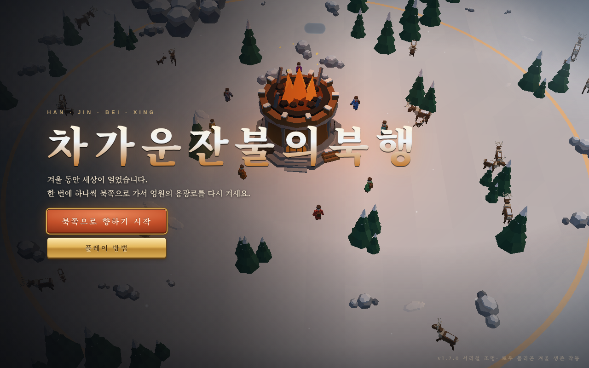
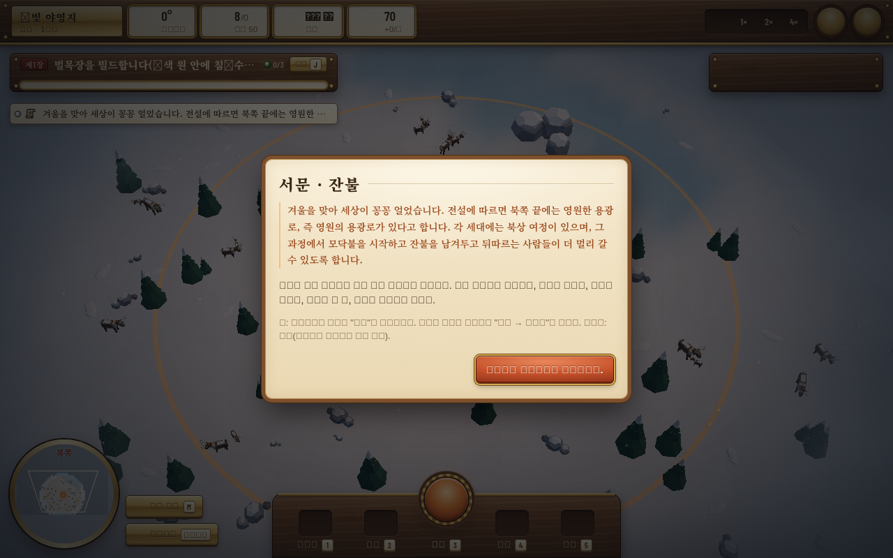

# 차가운 잔불의 북행 (Cold Embers) — 한국어판

얼어붙은 세계에서 야영지를 이끌고 한 정거장씩 북쪽으로 나아가, 전설의 「영원의 용광로」를 다시 밝히는 로우 폴리곤 겨울 생존 경영 게임입니다.

**지금 플레이:** https://sigco3111.github.io/cold-embers-ko/



## 소개

- 용광로를 중심으로 야영지를 건설하고, 채집·채굴·가공 건물로 생산 체인을 만듭니다.
- 정찰대를 보내 안개를 걷고 자원, 생존자, 전문가, 랜드마크를 찾습니다.
- 썰매 행렬로 야영지 사이에 물류망을 만들고, 조건이 갖춰지면 북쪽으로 이주합니다.
- 폭풍우, 한파, 늑대와 약탈자의 습격을 버텨내고, 세계의 척추를 넘어 끝없는 북방 지역까지.
- 진행 상황은 브라우저에 자동 저장됩니다(세이브 슬롯 3개, 10분마다 자동 백업).



## 조작

- 지도 드래그로 이동, 두 손가락 확대/회전 (PC: 휠 확대, 우클릭 또는 Q/E 회전)
- C: 생산 체인 보기 · G: 데이터 곡선 · M: 북행 지도 · H: 사진 모드
- 건설할 때 드래그로 미리 보고 ✓로 확정, PC에서는 좌클릭 드래그로 한 줄 배치

## 한국어판 안내

- 게임 내 모든 사용자 대상 문자열(메뉴, 패널, 스토리, 도움말, 업적, 수집첩 등)을 한국어로 옮겼습니다.
- 글꼴은 Noto Serif KR / Noto Sans KR 웹폰트를 사용합니다.
- 원본 저장 데이터 형식과 로컬 저장 키는 바꾸지 않았습니다.

## 원작 및 크레딧

- 원작: [寒烬北行 (Cold Embers)](https://github.com/worldv4nquisher-cyber/Cold-Embers) by worldv4nquisher-cyber
- 원작 데모: https://worldv4nquisher-cyber.github.io/Cold-Embers/
- 라이선스: GPL-3.0-or-later (원작과 동일, [LICENSE](LICENSE) 참조)
- 이 저장소는 원작의 한국어 번역판이며, 원작자의 코드와 에셋을 GPL-3.0 조건에 따라 수정·배포합니다.

## 개발

```bash
npm install
npm run build   # dist/index.html 생성 (단일 HTML 파일)
```

`main` 브랜치에 푸시하면 GitHub Actions가 자동으로 빌드해 GitHub Pages에 배포합니다.
